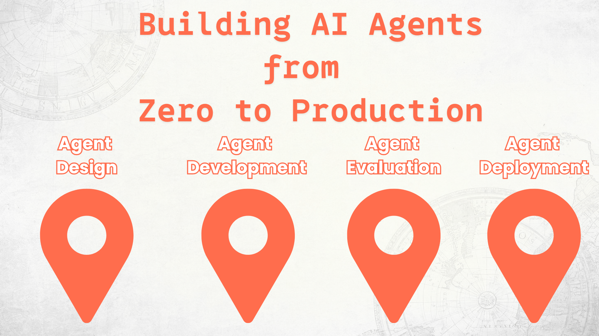

# Building AI Agents from Zero to Production



### 🌐 Multi-Language Support

#### Supported via GitHub Action (Automated & Always Up-to-Date)

<!-- CO-OP TRANSLATOR LANGUAGES TABLE START -->
[Arabic](./translations/ar/README.md) | [Bengali](./translations/bn/README.md) | [Bulgarian](./translations/bg/README.md) | [Burmese (Myanmar)](./translations/my/README.md) | [Chinese (Simplified)](./translations/zh-CN/README.md) | [Chinese (Traditional, Hong Kong)](./translations/zh-HK/README.md) | [Chinese (Traditional, Macau)](./translations/zh-MO/README.md) | [Chinese (Traditional, Taiwan)](./translations/zh-TW/README.md) | [Croatian](./translations/hr/README.md) | [Czech](./translations/cs/README.md) | [Danish](./translations/da/README.md) | [Dutch](./translations/nl/README.md) | [Estonian](./translations/et/README.md) | [Finnish](./translations/fi/README.md) | [French](./translations/fr/README.md) | [German](./translations/de/README.md) | [Greek](./translations/el/README.md) | [Hebrew](./translations/he/README.md) | [Hindi](./translations/hi/README.md) | [Hungarian](./translations/hu/README.md) | [Indonesian](./translations/id/README.md) | [Italian](./translations/it/README.md) | [Japanese](./translations/ja/README.md) | [Kannada](./translations/kn/README.md) | [Khmer](./translations/km/README.md) | [Korean](./translations/ko/README.md) | [Lithuanian](./translations/lt/README.md) | [Malay](./translations/ms/README.md) | [Malayalam](./translations/ml/README.md) | [Marathi](./translations/mr/README.md) | [Nepali](./translations/ne/README.md) | [Nigerian Pidgin](./translations/pcm/README.md) | [Norwegian](./translations/no/README.md) | [Persian (Farsi)](./translations/fa/README.md) | [Polish](./translations/pl/README.md) | [Portuguese (Brazil)](./translations/pt-BR/README.md) | [Portuguese (Portugal)](./translations/pt-PT/README.md) | [Punjabi (Gurmukhi)](./translations/pa/README.md) | [Romanian](./translations/ro/README.md) | [Russian](./translations/ru/README.md) | [Serbian (Cyrillic)](./translations/sr/README.md) | [Slovak](./translations/sk/README.md) | [Slovenian](./translations/sl/README.md) | [Spanish](./translations/es/README.md) | [Swahili](./translations/sw/README.md) | [Swedish](./translations/sv/README.md) | [Tagalog (Filipino)](./translations/tl/README.md) | [Tamil](./translations/ta/README.md) | [Telugu](./translations/te/README.md) | [Thai](./translations/th/README.md) | [Turkish](./translations/tr/README.md) | [Ukrainian](./translations/uk/README.md) | [Urdu](./translations/ur/README.md) | [Vietnamese](./translations/vi/README.md)

> **Prefer to Clone Locally?**
>
> This repository includes 50+ language translations which significantly increases the download size. To clone without translations, use sparse checkout:
>
> **Bash / macOS / Linux:**
> ```bash
> git clone --filter=blob:none --sparse https://github.com/microsoft/Building-AI-Agents-From-Zero-To-Production.git
> cd Building-AI-Agents-From-Zero-To-Production
> git sparse-checkout set --no-cone '/*' '!translations' '!translated_images'
> ```
>
> **CMD (Windows):**
> ```cmd
> git clone --filter=blob:none --sparse https://github.com/microsoft/Building-AI-Agents-From-Zero-To-Production.git
> cd Building-AI-Agents-From-Zero-To-Production
> git sparse-checkout set --no-cone "/*" "!translations" "!translated_images"
> ```
>
> This gives you everything you need to complete the course with a much faster download.
<!-- CO-OP TRANSLATOR LANGUAGES TABLE END -->

## A course teaching you the fundamentals of the AI Agent Development Lifecycle

[](https://github.com/microsoft/Building-AI-Agents-From-Zero-To-Production/blob/master/LICENSE?WT.mc_id=academic-105485-koreyst)
[](https://GitHub.com/microsoft/Building-AI-Agents-From-Zero-To-Production/graphs/contributors/?WT.mc_id=academic-105485-koreyst)
[](https://GitHub.com/microsoft/Building-AI-Agents-From-Zero-To-Production/issues/?WT.mc_id=academic-105485-koreyst)
[](https://GitHub.com/microsoft/Building-AI-Agents-From-Zero-To-Production/pulls/?WT.mc_id=academic-105485-koreyst)
[](http://makeapullrequest.com?WT.mc_id=academic-105485-koreyst)

[](https://discord.gg/Kuaw3ktsu6)

## 🌱 Getting Started

This course has lessons covering the fundamentals of building and deploying AI Agents.

Each lesson builds on the previous one, so we recommend starting from the beginning and working your way through to the end.

If you want to explore more about AI Agent topics, you can check out the [AI Agents For Beginners Course](https://aka.ms/ai-agents-beginners).

### Meet Other Learners, Get Your Questions Answered

If you get stuck or have any questions about building AI Agents, join our dedicated Discord Channel in the [Microsoft Foundry Discord](https://discord.gg/Kuaw3ktsu6).

### What You Need

Each Lesson has its own code sample that you can run locally. You can [fork this repo](https://github.com/microsoft/Building-AI-Agents-From-Zero-To-Production/fork) to create your own copy.

This course currently uses the following:

- [Microsoft Agent Framework (MAF)](https://aka.ms/ai-agents-beginners/agent-framework)
- [Microsoft Foundry](https://azure.microsoft.com/products/ai-foundry) — a project with a deployed **GPT-5 series** model (for example `gpt-5.1`). Do **not** use the retired GPT-4o / GPT-4.1 models.
- [Azure OpenAI Service](https://azure.microsoft.com/products/ai-foundry/models/openai)
- [Azure CLI](https://learn.microsoft.com/cli/azure/authenticate-azure-cli?view=azure-cli-latest) — sign in with `az login` before running any sample
- **Python 3.12 or later**

Please ensure you have access to these services before getting started.

### Develop in a Container

The [devcontainer configuration](./.devcontainer/devcontainer.json) provides Python 3.12,
Node.js 22, Azure CLI, Azure Developer CLI (`azd`), Docker CLI, and Python and Bicep
extensions for VS Code. It also works in GitHub Codespaces.

1. For local development, install Docker Desktop (or another Docker-compatible runtime) and the VS Code **Dev Containers** extension, then start Docker.
2. Open this repository in VS Code and run **Dev Containers: Reopen in Container** from the Command Palette, or create a Codespace for the repository.
3. Wait for setup to install the root Python requirements in `/home/vscode/.venvs/course`, selected automatically for Python and new terminals. Do not activate a virtual environment created on your host OS.
4. Create a root `.env` from [`.env.example`](./.env.example), preserving any existing values, and fill in your Microsoft Foundry project and model settings.
5. In the container terminal, sign in with `az login --use-device-code`. For deployment lessons, also run `azd auth login --use-device-code`.

Follow the lesson instructions to run samples. DevUI ports **8090-8096**, the A2A
server port **9000**, and ChatKit ports **3000** and **8001** are forwarded automatically.
No agents are started and no Azure resources are provisioned during container setup.

Lesson 4 has additional backend, hosted-agent, and frontend dependencies. Follow its
[setup instructions](./lesson-4-agentdeployment/README.md#quick-start), using separate
virtual environments for its Python components: the hosted agent pins a different SDK
version from the root course requirements. Install frontend packages with `npm install`
from its frontend directory.

When using browser-based GitHub Codespaces, start the frontend from that directory
with its forwarded hostname explicitly allowed by running
`__VITE_ADDITIONAL_SERVER_ALLOWED_HOSTS="${CODESPACE_NAME}-3000.${GITHUB_CODESPACES_PORT_FORWARDING_DOMAIN}" npm run dev`.

The container can access the host Docker daemon to build lesson 4 images. Only open
trusted repositories in it, because Docker access grants control over the host daemon.
Azure credentials are not mounted from your host; sign in inside the container again
after rebuilding it. Existing `.env` files are never overwritten by container setup.

> **💰 Cost & cleanup.** The hands-on lessons create real Azure resources — a Microsoft Foundry
> project, a model deployment, a vector store, and (in Lessons 4–6) hosted agents and toolboxes.
> These can incur cost while they exist. When you finish a lesson — or the course — delete the
> resources you no longer need. The simplest approach is to put everything in a dedicated resource
> group and delete the whole group when you're done:
>
> ```bash
> az group delete --name <your-resource-group> --yes --no-wait
> ```
>
> You can also delete individual agents, vector stores, and toolboxes from the Foundry portal.

> **Note on models.** This course serves all models through **Microsoft Foundry**. It does **not**
> use *GitHub Models*, which is being retired on **July 30, 2026** — Microsoft Foundry is the
> official migration path. If you have older code that calls GitHub Models, point it at a Foundry
> model deployment instead.

More options around model hosting and services coming soon.

## 🗃️ Lessons

| **Lesson**         | **Description**                                                                                  |
|--------------------|--------------------------------------------------------------------------------------------------|
| [Agent Design](./lesson-1-agent-design/README.md)       | An introduction to our "Developer Onboarding" Agent Use Case and how to design effective agents  |
| [Agent Development](./lesson-2-agent-development/README.md)  | Using the Microsoft Agent Framework (MAF), build a set of specialised agents to help new developers onboard.       |
| [Agent Evaluations](./lesson-3-agent-evals/README.md)  | Using Microsoft Foundry, find out how well our AI Agents are performing and how to improve them. |
| [Agent Deployment](./lesson-4-agentdeployment/README.md)   | Using Microsoft Foundry hosted agents and OpenAI ChatKit, see how to deploy an AI Agent into production.       |
| [Production Hosted Agents](./lesson-5-hosted-agents-production/README.md)   | Take a hosted agent to enterprise production: Hosted Agents vs Capability Hosts, bring-your-own storage, memory, and governance.       |
| [Microsoft Toolbox](./lesson-6-toolbox/README.md)   | Define tools once and govern them centrally: build a toolbox, consume it from an agent via one MCP endpoint, and version tools safely.       |
| [Multi-Agent & A2A](./lesson-7-multi-agent-a2a/README.md)   | Compose agents as networked services: expose an agent over the open Agent-to-Agent (A2A) protocol and consume a remote agent as a peer.       |


## 🎒 Other Courses

Our team produces other courses! Check out:

<!-- CO-OP TRANSLATOR OTHER COURSES START -->
### LangChain
[](https://aka.ms/langchain4j-for-beginners)
[](https://aka.ms/langchainjs-for-beginners?WT.mc_id=m365-94501-dwahlin)
[](https://github.com/microsoft/langchain-for-beginners?WT.mc_id=m365-94501-dwahlin)
---

### Azure / Edge / MCP / Agents
[](https://github.com/microsoft/AZD-for-beginners?WT.mc_id=academic-105485-koreyst)
[](https://github.com/microsoft/edgeai-for-beginners?WT.mc_id=academic-105485-koreyst)
[](https://github.com/microsoft/mcp-for-beginners?WT.mc_id=academic-105485-koreyst)
[](https://github.com/microsoft/ai-agents-for-beginners?WT.mc_id=academic-105485-koreyst)

---

### Generative AI Series
[](https://github.com/microsoft/generative-ai-for-beginners?WT.mc_id=academic-105485-koreyst)
[-9333EA?style=for-the-badge&labelColor=E5E7EB&color=9333EA)](https://github.com/microsoft/Generative-AI-for-beginners-dotnet?WT.mc_id=academic-105485-koreyst)
[-C084FC?style=for-the-badge&labelColor=E5E7EB&color=C084FC)](https://github.com/microsoft/generative-ai-for-beginners-java?WT.mc_id=academic-105485-koreyst)
[-E879F9?style=for-the-badge&labelColor=E5E7EB&color=E879F9)](https://github.com/microsoft/generative-ai-with-javascript?WT.mc_id=academic-105485-koreyst)

---

### Core Learning
[](https://aka.ms/ml-beginners?WT.mc_id=academic-105485-koreyst)
[](https://aka.ms/datascience-beginners?WT.mc_id=academic-105485-koreyst)
[](https://aka.ms/ai-beginners?WT.mc_id=academic-105485-koreyst)
[](https://github.com/microsoft/Security-101?WT.mc_id=academic-96948-sayoung)
[](https://aka.ms/webdev-beginners?WT.mc_id=academic-105485-koreyst)
[](https://aka.ms/iot-beginners?WT.mc_id=academic-105485-koreyst)
[](https://github.com/microsoft/xr-development-for-beginners?WT.mc_id=academic-105485-koreyst)

---

### Copilot Series
[](https://aka.ms/GitHubCopilotAI?WT.mc_id=academic-105485-koreyst)
[](https://github.com/microsoft/mastering-github-copilot-for-dotnet-csharp-developers?WT.mc_id=academic-105485-koreyst)
[](https://github.com/microsoft/CopilotAdventures?WT.mc_id=academic-105485-koreyst)
<!-- CO-OP TRANSLATOR OTHER COURSES END -->

## Contributing

This project welcomes contributions and suggestions.  Most contributions require you to agree to a
Contributor License Agreement (CLA) declaring that you have the right to, and actually do, grant us
the rights to use your contribution. For details, visit <https://cla.opensource.microsoft.com>.

When you submit a pull request, a CLA bot will automatically determine whether you need to provide
a CLA and decorate the PR appropriately (e.g., status check, comment). Simply follow the instructions
provided by the bot. You will only need to do this once across all repos using our CLA.

This project has adopted the [Microsoft Open Source Code of Conduct](https://opensource.microsoft.com/codeofconduct/).
For more information see the [Code of Conduct FAQ](https://opensource.microsoft.com/codeofconduct/faq/) or
contact [opencode@microsoft.com](mailto:opencode@microsoft.com) with any additional questions or comments.

## Trademarks

This project may contain trademarks or logos for projects, products, or services. Authorized use of Microsoft
trademarks or logos is subject to and must follow
[Microsoft's Trademark & Brand Guidelines](https://www.microsoft.com/legal/intellectualproperty/trademarks/usage/general).
Use of Microsoft trademarks or logos in modified versions of this project must not cause confusion or imply Microsoft sponsorship.
Any use of third-party trademarks or logos is subject to those third-parties' policies.

## Getting Help

If you get stuck or have any questions about building AI apps, join:

[](https://discord.gg/Kuaw3ktsu6)

If you have product feedback or errors while building visit:

[](https://aka.ms/foundry/forum)
